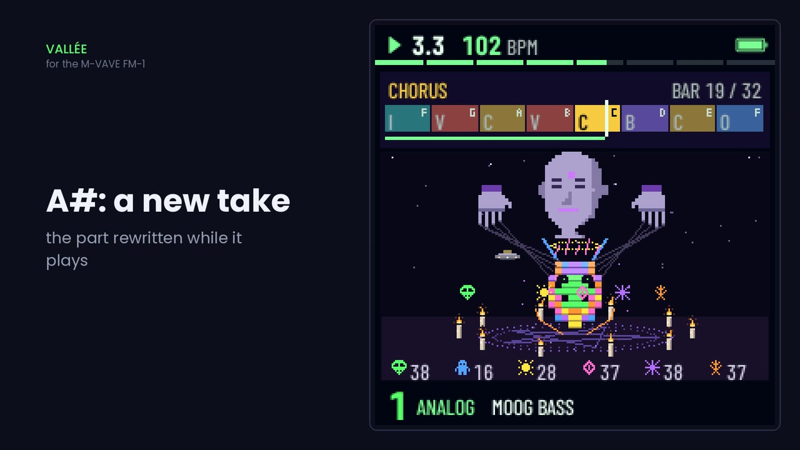
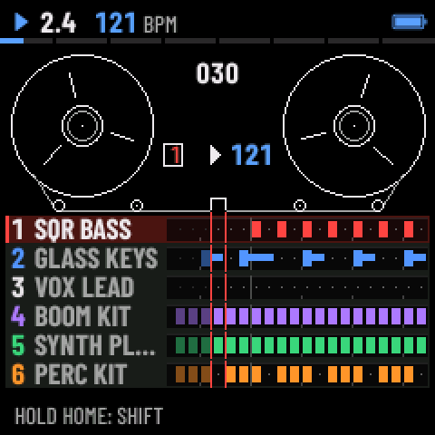
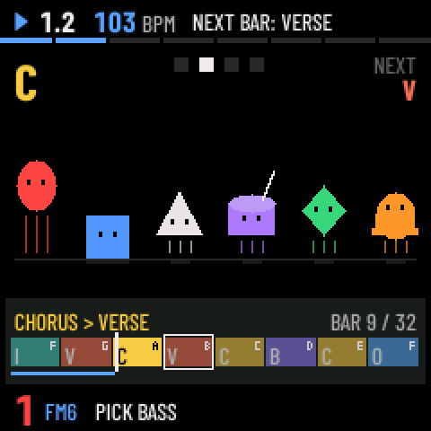

  

<h1 align="center">Vallée</h1>

<b>Firmware for the M-VAVE FM-1 that writes you a song, then lets you perform it.</b> 
<i>receiving signal from the other side</i>

  <a href="https://tammygucci.github.io/valee/webapp/installer/"><b>Install</b></a> ·
  <a href="https://tammygucci.github.io/valee/try/"><b>Try it in your browser</b></a> ·
  <a href="https://tammygucci.github.io/valee/webapp/editor/">Editor</a> ·
  <a href="https://tammygucci.github.io/valee/webapp/installer/brand/vallee_cheatsheet.pdf">Cheat sheet</a> ·
  <a href="VALLEE.md">Full manual</a>

  
  
   The demo and a live performance (click to play)

Vallée is built on [Skiff](https://github.com/illuminus5/skiff) 2.6 by illuminus5, a six-track groovebox firmware for
the FM-1. Skiff's engines, sequencer, editor and saves all work the same way here. Vallée adds a song generator, a
way to play a whole song live from the keys, an effects chain across the master mix, new synth voices and drum kits,
and its own look.

## What Vallée adds

### GEN: a song in one press

Pick a style, a vibe and a seed, and press OCT+. GEN writes all six tracks (bass, chords, lead, drums, colour and
percussion) in one of **twelve styles**: AETHER, LOTUS, ZETA, ORACLE, AKASHA, SIGIL, LEMURIA, ASTRAL, HEX, OBELISK,
SERAPH and WRAITH. Set PART to SONG and it writes a whole arrangement: intro, verses, choruses, a bridge and an outro.
Everything it writes is ordinary steps and sounds, so you can edit all of it afterwards. The same settings always
give the same song, so you can share a song as a short code.

### THE SPELL: play the song live

Tap HOME on HOME. The song's map runs across the top, and the keyboard becomes the song. Each white key is a section
of the song, and pressing one jumps every track to that section on the next bar line, so you're always in time. The
spare white keys are effects you hold: repeats, tape stop, filter sweeps, freeze and more. The black keys give you
the next part, **a new take** of the part that's playing (GEN rewrites it live), a new take of one track, and
**REC ARRANGE**, which records the order you play the parts in as the new song.

Below the map, the Alchemist pulls an element from each of your six tracks into a summoning circle as they play.
By the end of the song he has built a figure that comes from your sounds and your mix, different for every song.

 

### ALEMBIC: the whole mix through four vessels

A chain on the master mix: **DRIVE** (soft, hard, fold, fuzz), **MOTION** (phaser, flanger, chorus, wobble),
**SPACE** (echo, reverb or both) and **GRAIN** (tape wow, dust, crush, filter). Each stage has a BLEND knob, and
BLEND 0 switches that stage off completely. On screen they're four flasks, filled as far as each BLEND and moving
with the sound.

### New sounds

- **MOOG, OBERHEIM and JUNO filters** for the ANALOG engine, with 21 presets voiced after those instruments.
- **Three drum kits**: DEAD (a seventies studio kit damped with towels), TAPE (warm soul session) and CRUSH (a drum
  machine run too hot).

### Its own look

  
  
  

- **XENO**, the default: a tape-machine HOME with pentagram reels, and an original pixel creature for every sound
  (aliens, cryptids, psi orbs, crystals, sigils and mythic herbs, one family per track) that sings on its notes.
- **TEEN**: the same screens kept plain and minimal, in a classic portable synth's colours.
- **An opening**: a 6.8-second intro drawn after the "consciousness energy grid" of the declassified Gateway
  Process report, with its own binaural chime.

## Install

At your own risk, as with any FM-1 firmware. You can always go back.

1. Open the **[Vallée installer](https://tammygucci.github.io/valee/webapp/installer/)** in Chrome or Edge on a
   computer.
2. Connect the FM-1 by USB (straight into the computer, not through a hub) and follow the page.

The same page can take the FM-1 back to the official M-VAVE firmware. Your Skiff projects, presets and samples carry
over. The only exception is that a SLICE track or preset becomes an FM6 sound, because Vallée leaves SLICE out to fit
in the FM-1's memory ([why](VALLEE.md#room-on-the-fm-1)).

**If the FM-1 won't start:** Vallée leaves Skiff's update loader, recovery and save formats untouched, so
[Skiff's recovery steps](SKIFF.md#if-the-fm-1-does-not-start) all apply (use Vallée's installer where they say
Skiff's). Vallée also has its own fallback: if it crashes twice in a row within 30 seconds of switching on, the next
start goes into the chip's boot mode, where it can be written again.

## Learn it

- **[VALLEE.md](VALLEE.md)**: everything Vallée adds, in full.
- **[SKIFF.md](SKIFF.md)**: Skiff's manual, for everything Vallée shares with Skiff (the sequencer, engines, MIDI and
  menus).
- **[The cheat sheet](https://tammygucci.github.io/valee/webapp/installer/brand/vallee_cheatsheet.pdf)**: one page
  to keep next to the unit.

## Build it

GitHub Actions builds the firmware, runs every test and publishes the installer, editor and emulator. To build
locally, see [BUILDING.md](BUILDING.md) and
[VALLEE.md](VALLEE.md#building-the-web-version-the-web-installer).

## Credits

Vallée is a fork of **[Skiff](https://github.com/illuminus5/skiff)** by illuminus5, which is built on
**[Felucca](https://github.com/hugelton/Felucca)** by Leo Kuroshita (Hügelton Instruments), with the work of the
FM-1 community ([full credits](SKIFF.md#credits)). GEN's way of working (genre, seed, energy) comes from
**GENE** in [JIANT FM](https://github.com/juanjiant-bit/JIANT) by juanjiant-bit, while Vallée's generator code is
its own. If Vallée is useful to you, please [support Felucca's author](https://github.com/sponsors/hugelton).

## Licence

Free software under [GPL-3.0-only](LICENSE), as Skiff and Felucca are. If you share the firmware, share this source
with it. See [LICENSING.md](LICENSING.md) for the bundled fonts and DSP.

M-VAVE and FM-1 are trademarks of their owners. Vallée is not affiliated with or endorsed by M-VAVE, Skiff's or
Felucca's authors, Moog, Oberheim or Roland, or any artist a style leans toward.
